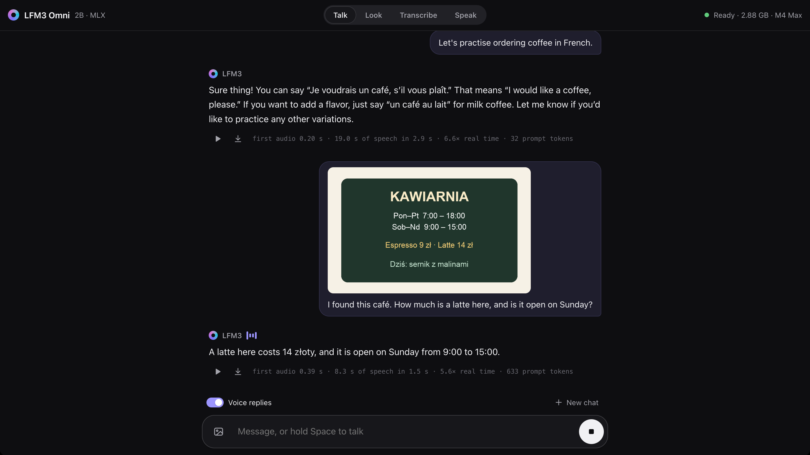
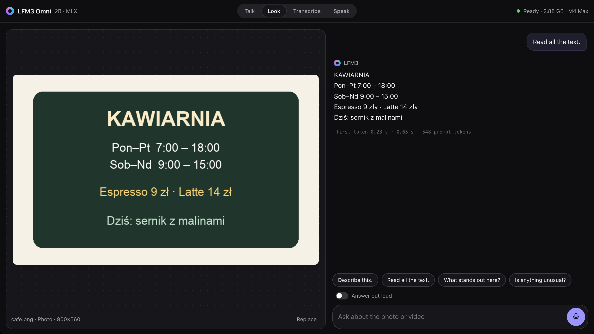

# LFM3 Omni demo

A local web app for [LiquidAI LFM3-Omni-2B](https://huggingface.co/LiquidAI/LFM3-Omni-2B) on a Mac with Apple Silicon. One 2B model listens, looks and speaks. The app runs the model with MLX through [mlx-vlm](https://github.com/Blaizzy/mlx-vlm). After the first download, the app does not use the internet.



## Functions

| Tab | Function |
|---|---|
| Talk | Chat by voice or by text. The model answers with speech and text. You can attach a photo. |
| Look | Ask about a photo, a camera picture or a video (60 s maximum). The model can also hear the sound of the video. |
| Transcribe | Change speech into text in 18 languages, or into text in a different language. Files can be 30 min long. |
| Speak | Change text into speech in 19 languages and accents, with a female or a male voice. |



## Requirements

- A Mac with Apple Silicon and 4 GB of free memory
- [uv](https://docs.astral.sh/uv/). It installs Python 3.12 and the packages.
- ffmpeg: `brew install ffmpeg`

## Start

```bash
git clone https://github.com/overment/lfm3-mega-demo
cd lfm3-mega-demo
./run
```

Open http://127.0.0.1:8642.

The first start downloads the model `LiquidAI/LFM3-Omni-2B-MLX-8bit` (2.9 GB). After that, the model loads in approximately 2 s.

Options:

- `./run --port 9000` uses a different port.
- `./run --model <name or folder>` uses a different MLX copy of the model. The copy must have the `audio_tokenizer/` folder, because the app needs it for speech.

Keys: hold **Space** to talk (Talk tab). Push **Esc** to stop. Push **1** to **4** to change the tab.

## Speed

We measured these values on an M4 Max with the 8-bit model:

- Voice chat: the first audio starts after 0.2 to 0.4 s. The model makes speech 6 to 7 times faster than real time.
- Text answers: approximately 150 tokens per second.
- Transcription: 58 s of audio in 0.7 s.

## How it works

- `app/engine.py`: One thread runs the model and does one job at a time. It reads text tokens and speech frames from `stream_slots()` in mlx-vlm. It changes the speech frames into audio in parts, and sends each part to the browser immediately.
- `app/server.py`: A FastAPI server. Each request sends back a stream of NDJSON events: `text`, `audio` (24 kHz PCM) and `done`.
- `app/media.py`: ffmpeg changes uploads into PNG, 16 kHz WAV and MP4 files.
- `web/`: HTML, CSS and JavaScript, with no build step.

Uploads and answers go into `data/files/`. The app deletes files that are older than 24 hours when it starts.

## Limits

- `pyproject.toml` pins mlx-vlm to a Git commit. A PyPI release of mlx-vlm does not have LFM3-Omni support yet.
- In voice chat, the model often answers spoken Polish in English. Typed text gets an answer in the same language.
- The app does not support live speech input.
- This is a 2B model. It is fast, but its answers can be incorrect.
- The server has no login. It listens only on `127.0.0.1`. Do not make it available on a network.

The model weights have their own license: [LFM Open License v1.0](https://huggingface.co/LiquidAI/LICENSE).
